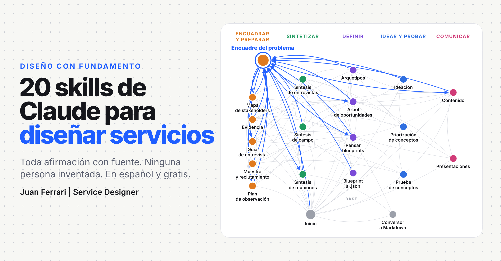
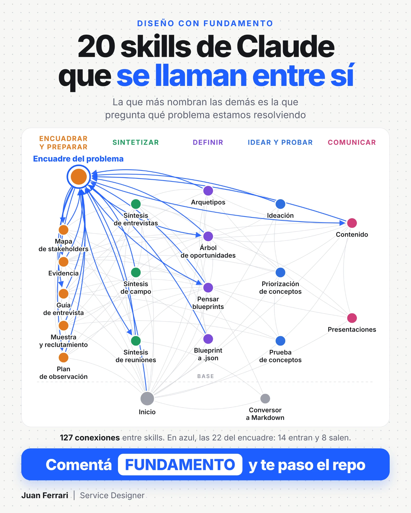
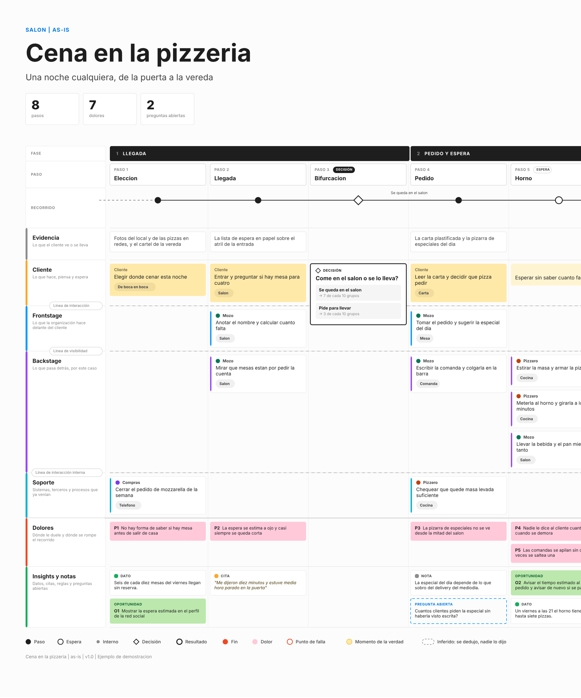

# Diseño con fundamento



20 skills de Claude, en español, para diseño de servicios, design thinking y mejora de procesos. Acompañan el trabajo de punta a punta: del pedido que llega como solución al problema bien planteado, de las fuentes a la síntesis, de la idea a la prueba y de ahí a la presentación.

Están pensadas para cualquier organización y cualquier herramienta, y para quien arranca tanto como para quien tiene años de oficio.

## Por qué existe

Casi todo lo que sale mal en un proyecto de diseño sale mal antes de diseñar: se resuelve el problema equivocado, se presenta una opinión como si fuera un dato o se inventa lo que no se investigó. Estas skills ponen el método en el camino para que eso no pase:

- **Toda afirmación lleva su fuente y su certeza.** Una sola escala para todo el paquete: hipótesis, indicio, patrón, evidencia sólida. Un conteo directo y un dato inferido nunca se mezclan.
- **No simulan personas.** Ninguna skill inventa entrevistas, citas, perfiles ni reacciones. Lo que no se investigó queda como hueco con nombre.
- **Frenan donde se decide.** Hacen solas lo mecánico y se detienen, con una propuesta concreta, donde hace falta criterio.
- **Se adaptan a quien las usa.** Con un pedido completo, siguen sin preguntar. Con huecos, preguntan solo lo que falta. Con alguien que arranca, guían con opciones.
- **Se llaman entre sí.** Si pedís una guía de entrevista sin problema encuadrado, la skill salta primero al encuadre. Funciona como una térmica: si falta un paso anterior, corta y te lleva ahí.

## Cómo se conectan

Cada línea es una skill que nombra a otra en sus instrucciones: le pide material, le pasa el resultado o le deriva lo que no le toca. Son 127 conexiones. La más conectada es `encuadre-del-problema`, con 22 (en azul): no es la que dibuja ni la que presenta, es la que pregunta qué problema estamos resolviendo. El conteo sale de `herramientas/contar-conexiones.py`.



## Las skills

Seis etapas y dos skills de base.

| Etapa | Skill | Qué hace |
|---|---|---|
| Base | `inicio` | Arma el contexto de tu organización con una entrevista corta y te dice por dónde empezar |
| Base | `markdown-converter` | PDF, Word, decks, planillas o audio a Markdown con nombre consistente |
| Encuadrar | `encuadre-del-problema` | Pasa un pedido a problema antes de diseñar; reencuadra después de investigar |
| Encuadrar | `mapa-de-stakeholders` | Actores, poder e interés con evidencia, tensiones y a quién hablar primero |
| Encuadrar | `evidencia` | De la pregunta a las fuentes, la consulta, el análisis y la certeza |
| Preparar el campo | `guia-de-entrevista` | Guía con hipótesis y criterios, y plan de campo en una página |
| Preparar el campo | `muestra-y-reclutamiento` | Muestra por segmento, filtro, modo guerrilla o pedido a otro equipo |
| Preparar el campo | `plan-de-observacion` | Qué mirar, dónde y cuándo, con hoja de registro |
| Sintetizar | `sintesis-de-entrevistas` | Ficha por entrevista y corpus que se acumula |
| Sintetizar | `sintesis-de-campo` | Veredicto por hipótesis y tablero, con entrevistas y observación |
| Sintetizar | `sintesis-de-reuniones` | Minuta con decisiones, acciones y temas abiertos |
| Definir | `arquetipos` | Personas, trabajos por hacer y mapa de empatía desde la evidencia |
| Definir | `arbol-de-oportunidades` | Métrica, resultado, oportunidades, por qués y soluciones con su supuesto |
| Definir | `pensar-blueprints` | Cuántos blueprints, dónde se cortan y un modelo trazable |
| Definir | `service-blueprint-json` | Un blueprint a mano para el plugin de FigJam, cuando no hay modelo |
| Idear y probar | `ideacion` | Cómo podríamos, expansión de ideas y fichas de concepto |
| Idear y probar | `priorizacion-de-conceptos` | Matriz calibrada, deseabilidad, factibilidad, viabilidad y el supuesto que mata |
| Idear y probar | `prueba-de-conceptos` | El prototipo más barato, el guion y la síntesis de las sesiones |
| Comunicar | `creador-de-contenido` | Qué decir y en qué orden: resultados, recomendación, rúbrica de calidad |
| Comunicar | `creador-de-ppt` | Decks .pptx con un sistema visual propio y 49 tipos de slide |

No hace falta usarlas en orden ni instalarlas todas. Si una skill necesita algo que produce otra que no tenés, hace la versión corta de ese paso y te lo dice.

## Instalar

### Claude Code (plugin)

```
/plugin marketplace add juanferrari456-lgtm/diseno-con-fundamento
/plugin install diseno-con-fundamento@diseno-con-fundamento
```

### Claude en la web o en la app (de a una)

En `instalar/` hay un `.zip` por skill. Subí los que quieras desde la sección de skills de la configuración de Claude. Para empezar, alcanza con `inicio` y `encuadre-del-problema`.

## Por dónde empezar

Pedile a Claude: "ayudame a empezar con Diseño con fundamento". La skill `inicio` te hace unas preguntas sobre tu organización (a quién sirve, qué fuentes de datos hay, quién hace cada paso) y guarda las respuestas en `contexto.md`. Todas las demás lo leen para no preguntarte lo mismo cada vez.

Si preferís completarlo a mano: `compartido/contexto-plantilla.md` es la plantilla y `compartido/contexto-ejemplo-ficticio.md` muestra una organización ficticia completa.

## Lo que necesitan algunos scripts

La mayoría de las skills son solo texto. Algunas traen scripts que Claude corre si están disponibles:

| Skill | Necesita |
|---|---|
| `sintesis-de-entrevistas`, `sintesis-de-campo`, `sintesis-de-reuniones`, `pensar-blueprints`, `service-blueprint-json` | Node.js |
| `creador-de-ppt` | Node.js y `pptxgenjs` |
| `evidencia`, `arbol-de-oportunidades` | Python 3 |
| `mapa-de-stakeholders` | Python 3 y `openpyxl` |
| `markdown-converter` | `uv` para correr `markitdown` |

## El plugin de FigJam

**Blueprint from .json** es un plugin público de FigJam que dibuja el service blueprint con su propio design system: https://www.figma.com/community/plugin/1677322978727404526

Lee directo el modelo de `pensar-blueprints`: se sueltan juntos `arquitectura.json` y los archivos de cada blueprint, y dibuja una portada del discovery y un board por blueprint. `service-blueprint-json` queda para armar un archivo a mano cuando no hay modelo.



*Ejemplo ficticio que trae el plugin: una cena en una pizzería, de la puerta a la vereda.*

## Estructura

```
compartido/        principios, escala de certeza y plantilla de contexto (fuente única)
skills/<skill>/    SKILL.md, references/, scripts/, assets/
instalar/          un .zip por skill
docs/img/          imágenes del README
herramientas/      armar-zips.py, barrer-datos.py y contar-conexiones.py
.claude-plugin/    plugin.json y marketplace.json
```

Si editás algo de `compartido/`, corré `python3 herramientas/armar-zips.py`: copia los principios dentro de cada skill y rearma los `.zip`. Antes de publicar un cambio, `python3 herramientas/barrer-datos.py` busca mails, IDs y los términos de tu lista privada `.terminos-privados.txt`, que no se sube al repo.

## Ejemplos

Todos los casos son ficticios y lo dicen: una red de gimnasios y un taller mecánico de barrio. Ningún dato viene de una organización real.

## Licencia y créditos

Código bajo MIT y textos bajo CC BY 4.0. Detalle en `LICENSE`. Inspiración y herramientas en `CREDITOS.md`.

Hecho por Juan Ferrari.
